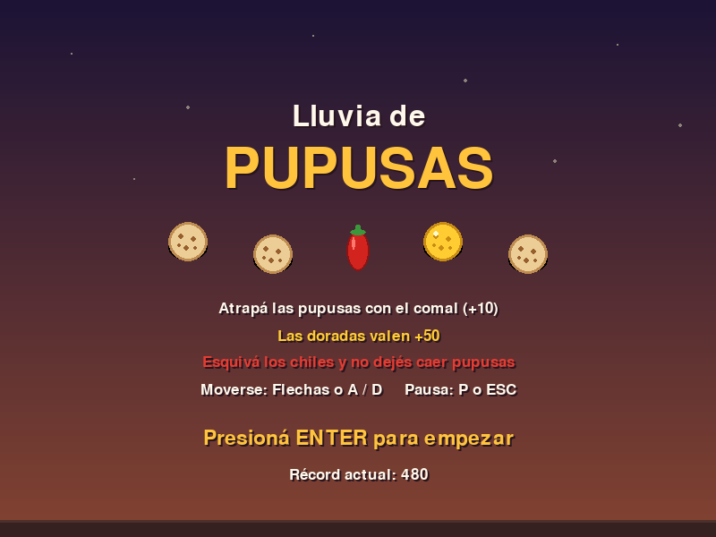
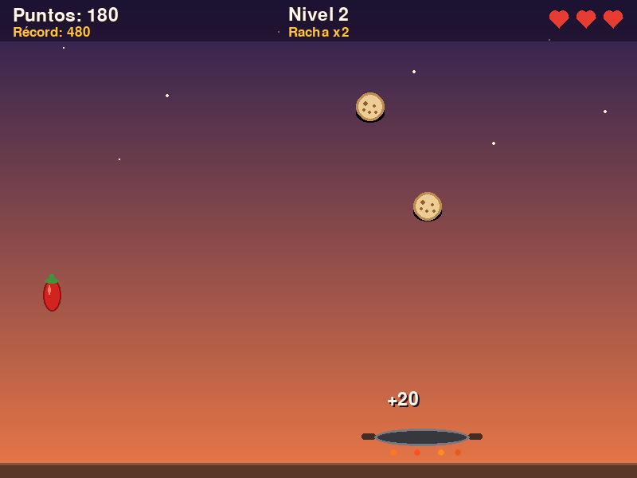
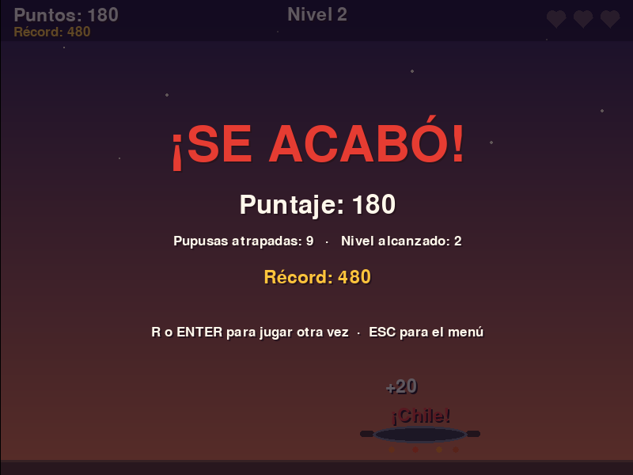

# 🫓 Lluvia de Pupusas

Mini-juego 2D en **Python + Pygame** desarrollado con la técnica de **vibecoding guiado**: la IA se usó como copiloto de programación, mientras que el diseño, la revisión, las pruebas y los ajustes los hice yo.

| | |
|---|---|
| **Participante** | Abraham Bladimir Umanzor Vásquez |
| **Programa** | Bootcamp AI for Developers |
| **Institución** | Kodigo |
| **Módulo** | Semana 2 – Vibecoding |
| **Actividad** | Vibecoding guiado: desarrollo de una aplicación o mini-juego con IA como copiloto |
| **Modalidad** | Individual |



---

## 1. Descripción del juego

Del cielo llueven pupusas y el jugador controla un **comal** en la parte inferior de la pantalla. El objetivo es atrapar la mayor cantidad posible sin perder las tres vidas.

| Objeto | Qué pasa si lo atrapás | Qué pasa si cae al suelo |
|---|---|---|
| 🫓 Pupusa | +10 puntos (× multiplicador) | Perdés una vida |
| 🟡 Pupusa dorada | +50 puntos (× multiplicador) | No pasa nada |
| 🌶️ Chile | Perdés una vida y se reinicia la racha | No pasa nada |

**Mecánicas adicionales**

- **Racha y multiplicador:** cada 5 pupusas seguidas sin fallar el multiplicador sube (máximo ×3).
- **Niveles:** cada 150 puntos sube el nivel; los objetos caen más rápido, aparecen con más frecuencia y hay más chiles.
- **Récord persistente:** el mejor puntaje se guarda en `datos/record.json`.
- **Estados:** menú, jugando, pausa y fin de partida.
- **Retroalimentación visual:** textos flotantes (+10, ¡Chile!, ¡Se cayó!) y sacudida de pantalla al perder una vida.

### Controles

| Tecla | Acción |
|---|---|
| `←` `→` o `A` `D` | Mover el comal |
| `ENTER` / `ESPACIO` | Empezar |
| `P` o `ESC` | Pausar / continuar |
| `Q` (en pausa) | Volver al menú |
| `R` (al perder) | Jugar otra vez |

| Jugando | Fin de partida |
|---|---|
|  |  |

---

## 2. Instalación y ejecución

Requisitos: **Python 3.10 o superior**.

```bash
git clone https://github.com/Chester21U/lluvia-de-pupusas.git
cd lluvia-de-pupusas

python -m venv venv
# Windows
venv\Scripts\activate
# Linux / macOS
source venv/bin/activate

pip install -r requirements.txt
python main.py
```

Para correr las pruebas automáticas:

```bash
python -m pytest -v
```

---

## 3. Estructura del proyecto

```
lluvia-de-pupusas/
├── main.py              Punto de entrada
├── juego/
│   ├── config.py        Constantes: tamaños, velocidades, probabilidades, colores
│   ├── logica.py        Reglas del juego (sin Pygame): jugador, objetos, colisiones, puntaje, niveles
│   ├── records.py       Lectura y guardado del récord en JSON
│   └── app.py           Ventana, eventos de teclado, estados y dibujo con Pygame
├── tests/
│   └── test_logica.py   18 pruebas automáticas con pytest
├── docs/capturas/       Capturas del juego
├── requirements.txt
└── README.md
```

La decisión de arquitectura más importante fue **separar la lógica (`logica.py`) del dibujo (`app.py`)**. Así las reglas del juego se pueden probar con `pytest` sin abrir ninguna ventana.

---

## 4. Evidencia de vibecoding (prompts)

Herramienta de IA utilizada: **Claude** · Editor: **VS Code**

### Prompt 1 — Base del juego

> Quiero hacer un mini-juego en Python con Pygame llamado "Lluvia de Pupusas". El jugador controla un comal en la parte de abajo con las flechas izquierda/derecha y tiene que atrapar pupusas que caen del cielo. Cada pupusa atrapada suma 10 puntos. Si una pupusa cae al suelo pierde una vida; tiene 3 vidas. Mostrá el puntaje y las vidas arriba. Ventana de 800×600 a 60 FPS. Todavía no necesito menú, solo que funcione el ciclo principal.

**Qué se pidió:** el núcleo jugable mínimo: ventana, movimiento del comal, objetos que caen, colisión, puntaje y vidas.

**Por qué así:** empecé con un alcance chico a propósito. Si pedía todo de una vez (menú, niveles, récord, sonidos) iba a ser difícil revisar el código y encontrar errores. Primero quería ver que lo básico funcionara.

**Resultado:** el juego corría, pero todo estaba en un solo archivo de más de 150 líneas y el comal se movía sumando una cantidad fija de píxeles **por cuadro** (`x += 8`).

---

### Prompt 2 — Refinamiento: arquitectura y movimiento con delta time

> El código funciona pero está todo en un solo archivo. Separalo en módulos: `config.py` con todas las constantes, `logica.py` con las clases Jugador, Objeto y Partida SIN usar pygame, y `app.py` solo para dibujar y leer el teclado. Además, el movimiento depende de los FPS: si la compu va más lenta el juego también. Cambiá todo para que use delta time (velocidad en píxeles por segundo × dt).

**Qué se pidió:** reorganizar el proyecto y corregir la dependencia de los FPS.

**Por qué se refinó:** al revisar el primer resultado noté dos problemas. El primero, que mezclar lógica y dibujo hace imposible probar las reglas sin abrir una ventana. El segundo, que con `x += 8` por cuadro, en una computadora a 30 FPS el comal se movería a la mitad de velocidad que en una a 60 FPS. Lo detecté porque al limitar el reloj a 30 FPS el juego se sentía "en cámara lenta".

**Resultado:** el proyecto quedó dividido en módulos con responsabilidades claras. Todo el movimiento ahora se calcula como `velocidad * dt`.

---

### Prompt 3 — Mejora de jugabilidad: chiles, pupusas doradas y niveles

> Agregá dos tipos de objetos nuevos: pupusas doradas que valen 50 puntos y salen con 6% de probabilidad, y chiles que quitan una vida si los atrapás (si un chile cae al suelo no pasa nada). También quiero niveles: cada 150 puntos sube el nivel, los objetos caen más rápido, salen más seguido y hay más chiles. Poné un límite para que no se vuelva imposible. Agregá también una racha: cada 5 pupusas seguidas el multiplicador sube, máximo x3.

**Qué se pidió:** más variedad y una curva de dificultad.

**Por qué se refinó:** al probar la versión anterior, después de un minuto el juego se volvía aburrido porque siempre era igual. Los chiles obligan a decidir (no se puede atrapar todo) y los niveles dan sensación de progreso. Pedí límites explícitos (`SPAWN_MIN`, `PROB_CHILE_MAX`) porque en una primera prueba la frecuencia de aparición llegaba a valores casi de cero y la pantalla se llenaba de objetos.

**Resultado:** tipos de objeto en `config.PUNTOS`, métodos `elegir_tipo()`, `velocidad_caida()`, `intervalo_spawn()` y la propiedad `multiplicador`.

---

### Prompt 4 — Mejora visual y estados del juego

> Ahora la parte visual: dibujá las pupusas como círculos color masa con manchitas quemadas, las doradas en amarillo, el chile rojo con tallo verde y el comal gris con brasas abajo. Fondo con degradado de atardecer. Agregá estados: menú con instrucciones, pausa con P o ESC y pantalla de fin con puntaje, pupusas atrapadas y nivel. Cuando atrapo algo que salga un texto flotante "+10" y cuando pierdo una vida que la pantalla se sacuda un poco. Guardá el récord en un archivo JSON.

**Qué se pidió:** presentación, manejo de estados y persistencia del récord.

**Por qué se refinó:** el juego funcionaba con rectángulos de colores y sin forma de pausar ni reiniciar sin cerrar la ventana. Sin figuras reconocibles no se entendía qué era cada objeto. Todo se dibuja con primitivas de Pygame (sin imágenes externas) para que el proyecto no dependa de archivos de recursos.

**Resultado:** una máquina de estados sencilla (`menu`, `jugando`, `pausa`, `game_over`) en `App.manejar_evento()`, funciones de dibujo por objeto y el módulo `records.py`.

---

### Prompt 5 — Corrección de errores encontrados al probar

> Encontré estos problemas: 1) si borro o daño el archivo record.json el juego se cae al iniciar con JSONDecodeError; 2) en niveles altos a veces una pupusa atraviesa el comal sin contarse; 3) en el menú las flechas ← → aparecen como cuadritos. Corregí los tres y escribí pruebas con pytest para la lógica (colisiones, vidas, niveles, récord) que no necesiten abrir ventana.

**Qué se pidió:** corregir errores reales encontrados durante las pruebas y automatizar la validación.

**Por qué se refinó:** estos errores no aparecieron en el código generado a simple vista; aparecieron jugando y forzando casos raros. Por eso le pedí también las pruebas, para que si vuelvo a cambiar algo pueda verificar rápido que no rompí nada.

**Resultado:** ver la sección 6.

---

## 5. Iteración y mejora

Resumen de cómo evolucionó el proyecto por cada iteración:

| Versión | Cambio solicitado | Tipo de mejora |
|---|---|---|
| v0.1 | Ciclo básico: comal, pupusas, puntaje, vidas | Funcionalidad base |
| v0.2 | Separación en módulos y movimiento con *delta time* | Lógica / arquitectura |
| v0.3 | Chiles, pupusas doradas, niveles y racha | Comportamiento / jugabilidad |
| v0.4 | Dibujo de objetos, fondo, menú, pausa, fin, récord | Visual / controles |
| v1.0 | Corrección de errores y pruebas automáticas | Validación |

La mejora más significativa fue la del **prompt 2**. No cambió nada visible para el jugador, pero hizo posible todo lo demás: sin separar la lógica no habría podido escribir las pruebas del prompt 5.

---

## 6. Validación del resultado

### 6.1 Cómo se probó

1. **Pruebas manuales jugando:** partidas completas hasta perder, probando cada tecla en cada estado (menú, pausa, fin) y verificando que el puntaje, las vidas y el nivel cambiaran como se esperaba.
2. **Casos forzados:** borrar y corromper `datos/record.json`, quedarse quieto en una esquina, mover el comal contra los bordes, dejar el juego llegar a niveles altos.
3. **Pruebas automáticas con `pytest`:** 18 pruebas sobre `logica.py` y `records.py`, sin ventana.

```
$ python -m pytest -q
..................                                                       [100%]
18 passed
```

Algunas de las pruebas incluidas:

| Prueba | Qué verifica |
|---|---|
| `test_jugador_no_sale_por_la_izquierda/derecha` | El comal no se sale de la pantalla |
| `test_movimiento_independiente_de_fps` | 30 cuadros a 30 FPS = 60 cuadros a 60 FPS |
| `test_atrapar_chile_quita_vida_y_reinicia_racha` | Regla del chile |
| `test_chile_que_cae_no_castiga` | Un chile que cae al suelo no quita vida |
| `test_objeto_rapido_no_atraviesa_el_comal` | Corrección del "efecto túnel" |
| `test_nivel_aumenta_dificultad` | Más velocidad y más objetos al subir de nivel |
| `test_simulacion_larga_sin_errores` | 20 000 cuadros simulados sin excepciones |
| `test_record_archivo_corrupto` | El juego no se cae con un JSON dañado |

### 6.2 Errores, limitaciones y ajustes encontrados

**Error 1 — El juego se caía con el archivo de récord dañado.**
La primera versión de `cargar_record()` hacía `json.load()` directamente. Si el archivo no existía o tenía texto inválido, el juego lanzaba `FileNotFoundError` o `JSONDecodeError` antes de mostrar la ventana.
*Ajuste:* se envolvió la lectura en `try/except` con las excepciones específicas (`OSError`, `JSONDecodeError`, `ValueError`, `TypeError`, `AttributeError`) y se devuelve 0. También se valida que el récord no sea negativo.

**Error 2 — "Efecto túnel" en niveles altos.**
En niveles altos un objeto puede avanzar en un solo cuadro más distancia que el alto del comal (22 px). Si en un cuadro estaba encima y en el siguiente ya estaba debajo, la colisión nunca se detectaba y la pupusa "atravesaba" el comal.
*Ajuste:* se agregó `cruzo_comal()`, que compara la posición del cuadro anterior con la actual para detectar si el objeto pasó a través del comal. La prueba `test_objeto_rapido_no_atraviesa_el_comal` lanza un objeto a 6000 px/s para verificarlo.

**Error 3 — Las flechas del menú salían como cuadritos.**
El texto "Moverse: ← →" se veía como dos rectángulos vacíos, porque la fuente por defecto de Pygame no incluye esos caracteres Unicode.
*Ajuste:* se cambió el texto a "Flechas o A / D". Lo detecté revisando la captura del menú.

**Ajuste en una prueba.**
Una prueba (`test_pupusa_que_cae_al_suelo_quita_vida`) falló al principio: la pupusa se colocaba en `ALTO + 5`, pero el juego solo la cuenta como caída cuando su borde superior pasa del borde de la pantalla (`y - radio > ALTO`). La lógica estaba bien; la prueba no. Se corrigió la posición a `ALTO + OBJETO_RADIO`. Esto me enseñó a no asumir que cuando una prueba falla el error siempre está en el código.

**Limitaciones conocidas**

- No tiene sonido (se dejó así para no depender de archivos de audio).
- Solo se controla con teclado.
- El récord es local y de un solo jugador.

---

## 7. Reflexión final

### Qué aprendí usando IA para programar

Aprendí que la IA rinde mucho mejor cuando le pido cosas **por partes y con detalle**. El primer prompt era corto y el resultado funcionaba, pero tenía decisiones que no me convencían, como poner todo en un archivo o mover el comal por cuadro. Cuando le expliqué exactamente qué quería y por qué (por ejemplo, "que no dependa de los FPS"), la respuesta fue mucho más precisa. Escribir un buen prompt se parece bastante a escribir buenos requisitos de software.

También aprendí que **que el código corra no significa que esté bien**. Los tres errores de la sección 6 no se veían leyendo el código: salieron al jugar, forzar casos raros y revisar las capturas.

### Ventajas y límites del vibecoding

**Ventajas**

- Velocidad: en poco tiempo tuve una base funcional que habría tardado mucho más en escribir desde cero.
- Me ayudó con detalles de Pygame que no tenía memorizados (dibujar elipses, superficies con transparencia, manejo del reloj).
- Permite experimentar: probar una mecánica nueva cuesta un prompt.

**Límites**

- La IA no prueba el juego por mí. No sabe si se siente lento, si una fuente no tiene un carácter o si un caso extremo rompe la colisión.
- Si el prompt es ambiguo, toma decisiones por su cuenta, y no siempre son las que yo habría tomado.
- Si no entiendo el código, no puedo saber si la respuesta es correcta, y con varias iteraciones el proyecto se puede volver difícil de mantener.

### Qué partes del código comprendo y cuáles necesito reforzar

**Comprendo bien:**

- El ciclo principal del juego (eventos → actualizar → dibujar) y el uso de `dt` para que el movimiento sea independiente de los FPS.
- La lógica de `Partida`: generación aleatoria de objetos, puntaje, vidas, racha, multiplicador y niveles.
- La máquina de estados del menú, la pausa y el fin de partida.
- El manejo de errores en `records.py` y por qué se capturan excepciones específicas.
- Las pruebas con `pytest` y el uso de `tmp_path` para no tocar el archivo real del récord.

**Necesito reforzar:**

- La colisión círculo-rectángulo (`colisiona()`): entiendo la idea de buscar el punto del rectángulo más cercano al centro del círculo, pero quiero practicar más la geometría detrás.
- La detección continua de colisiones (`cruzo_comal()`) para objetos muy rápidos.
- Superficies con transparencia en Pygame (`SRCALPHA`) y cómo se combinan al dibujar.
- El efecto de sacudida de pantalla, que funciona pero cuya fórmula ajusté más por prueba y error que por cálculo.

---

## 8. Tecnologías

- Python 3.10+
- Pygame 2.5+
- pytest
